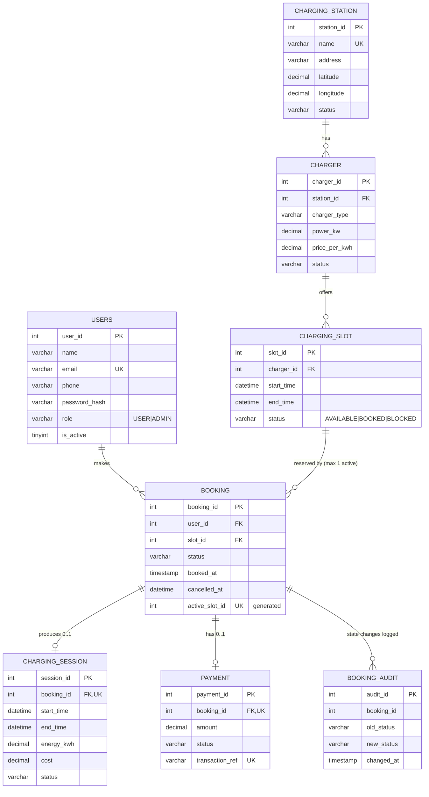

# Database Design

## 1. ER diagram

**Use `docs/ER_diagram.png` in the report** — it is generated from the live database (`scripts/make_er_diagram.py`), so it always matches the schema.
(An older diagram in `docs/aarya/` showed a table `app_user` and columns `city`, `open_time`, `label`, `paid_at` that do not exist, and drew slot→booking as 1:0..1; it was removed.)
The Mermaid version below is the same design in text form (renders on GitHub / VS Code / mermaid.live).



Cardinalities: station 1—N charger · charger 1—N slot · user 1—N booking · slot 1—N booking rows over time
but **at most one active** (CONFIRMED/IN_PROGRESS) · booking 1—0..1 session · booking 1—0..1 payment.

## 2. Relational schema (PK underlined by `*`, FK with →)

```
users(*user_id, name UNIQUE, email UNIQUE, phone, password_hash, role, is_active, created_at)
charging_station(*station_id, name UNIQUE, address, latitude, longitude, status, created_at)
charger(*charger_id, station_id → charging_station, charger_type, power_kw, price_per_kwh, status)
charging_slot(*slot_id, charger_id → charger, start_time, end_time, status, UNIQUE(charger_id,start_time))
booking(*booking_id, user_id → users, slot_id → charging_slot, status, booked_at, cancelled_at,
        active_slot_id [generated], UNIQUE(active_slot_id))
charging_session(*session_id, booking_id → booking UNIQUE, start_time, end_time, energy_kwh, cost, status)
payment(*payment_id, booking_id → booking UNIQUE, amount, status, transaction_ref UNIQUE, created_at)
booking_audit(*audit_id, booking_id, old_status, new_status, changed_at)
app_setting(*setting_key, setting_value, description)
```

## 3. Constraints used
* **PK / FK** on every table; all FKs are `ON DELETE RESTRICT` — history can never be orphaned or silently cascaded away.
* **UNIQUE:** `users.email`, `users.name` (the name is also the login id), `station.name`, `(charger_id, start_time)`, `booking.active_slot_id`, `session.booking_id`, `payment.booking_id`, `payment.transaction_ref`.
* **CHECK:** latitude/longitude ranges, status/type/role value lists, `power_kw > 0`, `price_per_kwh >= 0`, `end_time > start_time`, `energy_kwh >= 0`, `cost >= 0`, phone pattern.
* **Generated column** `booking.active_slot_id = IF(status IN ('CONFIRMED','IN_PROGRESS'), slot_id, NULL)` + UNIQUE ⇒ the database itself guarantees *one active booking per slot* (details in `DBMS_Viva_Notes.md`).
* **Triggers:** `trg_booking_ai`, `trg_booking_au` write every status change to `booking_audit`.

## 4. Normalization
* **1NF** – all columns atomic; no repeating groups (a user's bookings are rows, not columns).
* **2NF** – every table has a single-column surrogate PK, so no partial dependency is possible; `charging_slot` is also identified by `(charger_id, start_time)` and its non-key attributes depend on the whole key.
* **3NF** – no transitive dependencies: station facts (name, address, lat/long) live only in `charging_station`; charger facts (type, power, price) only in `charger`; user facts only in `users`. A booking stores *only* `user_id` and `slot_id`; station/charger names are obtained by JOIN (the views). `cost` in `charging_session` is a *recorded fact* (price at the time of charging), not a derivable duplicate — prices can change later, so storing it is correct design.
* Deliberate redundancy: `charging_slot.status` duplicates what could be derived from `booking`. It is kept for fast availability queries and is always changed in the **same transaction** as the booking row; integrity query Q11/Q12 in `05_queries.sql` proves they never disagree.

## 5. Indexes (for frequent searches)
| Index | Serves |
|---|---|
| `ix_station_location (latitude, longitude)` | nearby-station bounding-box search |
| `ix_station_status`, `ix_charger_station`, `ix_charger_type` | filter by status / type, station → chargers join |
| `uq_slot_charger_start (charger_id, start_time)` | slot lookup per charger + no duplicate start times |
| `ix_slot_status_start (status, start_time)` | `Available_Slots_View` |
| `ix_booking_user (user_id, booked_at)` | user history, newest first |
| `uq_active_slot`, `ix_booking_slot`, `ix_booking_status` | concurrency guard, slot → bookings join |
| `uq_session_booking`, `uq_payment_booking` | 0..1 session / payment per booking |
